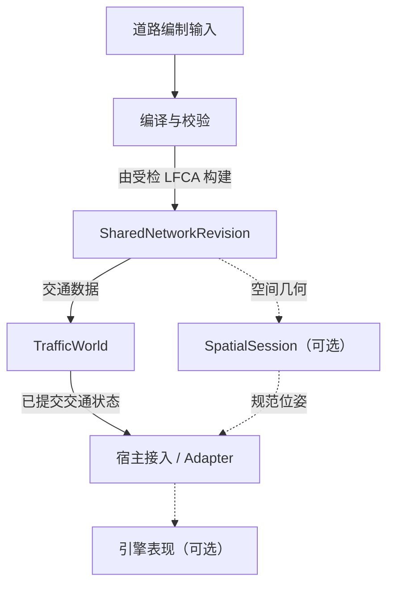

<p align="center">
  <picture>
    <source media="(prefers-color-scheme: dark)" srcset="assets/brand/laneflow-mark-dark.svg">
    <source media="(prefers-color-scheme: light)" srcset="assets/brand/laneflow-mark.svg">
    
  </picture>
</p>

<h1 align="center">LaneFlow</h1>

<p align="center">
  可嵌入、引擎无关、确定性的道路交通运行时与工具链
</p>

<p align="center">
  <code>确定性固定步进</code> · <code>共享静态路网</code> · <code>引擎适配</code>
</p>

LaneFlow 把受检静态路网转换为可共享修订，并在宿主控制下推进道路机动车交通。

> [!IMPORTANT]
> **LaneFlow 仍处于 1.0 前。** 当前工作区 crate 均为 `0.0.0` 且
> `publish = false`，仅支持从源码集成；API 与格式可能直接调整。

## 快速开始

需要 Git、[rustup](https://rustup.rs/) 和 Rust 1.99.1：

```powershell
git clone https://github.com/illusion-tech/laneflow.git
cd laneflow
cargo +1.99.1 run --locked -p laneflow-bevy --example quickstart --features native-example
```

窗口中可以看到两辆车沿车道移动，浅色车头标记显示行驶朝向；关闭窗口结束。
车道来自同一共享路网修订的空间中心线，车辆通过 Session 绑定并同步完整位姿。
这是有限路线夹具：车辆会等待信号，行程结束后不回流；重新运行可重播。

想看持续车流或复杂路口，可以换用其他示例：

| 示例               | 适合场景                     | 行为                                 |
| ------------------ | ---------------------------- | ------------------------------------ |
| `quickstart`       | 最小接入、车辆绑定与位姿同步 | 两辆车，有限路线，完成后不回流       |
| `corridor_traffic` | 持续车流与宿主生命周期       | 默认 100 车，支持 50–200，完成后回流 |
| `junction_debug`   | 复杂路口领域观测与可视诊断   | 确定性场景，F2 开关只读诊断 overlay  |

参数与完整命令见 [`laneflow-bevy` 示例](crates/laneflow-bevy/README.md#示例)。

<details>
<summary>无窗口验证</summary>

不打开窗口，确认最小示例的装配、绑定与位姿同步链路：

```powershell
cargo +1.99.1 test --locked -p laneflow-bevy --test quickstart_smoke
```

参与开发时的完整工作区检查见[贡献指南 · 测试与验证](CONTRIBUTING.md#8-测试与验证)。

</details>

## 能力与职责边界

| 能力           | 当前支持                                                           |
| -------------- | ------------------------------------------------------------------ |
| 静态路网       | 编译与检查静态制品，构建可跨世界共享的路网修订                     |
| 交通推进       | 跟驰、信号遵守、等待区与冲突区联合裁决、显式路权策略和停车生命周期 |
| 世界管理       | 快照保存与恢复、路网修订切换                                       |
| 宿主接口       | 已提交交通观测、候选路线接入，以及由宿主控制的生命周期操作         |
| 空间与表现接入 | 可选位姿采样、按需位姿提取和引擎适配                               |
| 执行方式       | 确定性固定步进，支持单世界多 worker 执行                           |
| 参考集成       | Bevy 0.20 适配，以及最小入门、持续车流和复杂路口诊断示例           |

宿主负责交通需求、出发计划、路线选择策略与 Routing 算法，以及引擎生命周期与最终
表现；LaneFlow 不内置专业交通工程分析。

当前只交付道路机动车特化和 Bevy 0.20 Reference Adapter。交通参与单元与交通执行域
是长期抽象方向，不代表已经支持其他执行域，也不构成交付时间承诺。

## 架构概览

下图展示静态路网的编制、共享消费及宿主集成关系。虚线表示可选的空间与表现路径。



- `TrafficWorld` 与 `SpatialSession` 绑定同一份共享路网修订；无窗口运行可以只使用
  Runtime。
- 位姿采样由宿主或 Adapter 编排：读取 Runtime 的已提交位姿来源，交给 Spatial 采样，
  再应用到引擎实体。Runtime 与 Spatial 互不依赖，图中省略具体调用与返回过程。
- 路线由宿主提供，在每个世界中通过 `TrafficWorld::register_route` 注册，不写入静态
  路网制品。

详细职责与依赖方向见[架构说明](docs/architecture.md)和
[Traffic Runtime 共享静态路网消费契约](docs/design/traffic-runtime-shared-consumption.md)。

## 接入与文档

| 我想做什么             | 阅读入口                                                                                                                         |
| ---------------------- | -------------------------------------------------------------------------------------------------------------------------------- |
| 运行示例或接入 Bevy    | [`laneflow-bevy`](crates/laneflow-bevy/README.md)                                                                                |
| 嵌入无窗口交通运行时   | [`laneflow-runtime`](crates/laneflow-runtime/README.md)                                                                          |
| 编制路网、了解静态制品 | [`laneflow-compiler`](crates/laneflow-compiler/README.md)、[`laneflow-static-network`](crates/laneflow-static-network/README.md) |
| 组织参考场景与车辆生成 | [`laneflow-scenario`](crates/laneflow-scenario/README.md)                                                                        |
| 理解架构和宿主职责     | [架构说明](docs/architecture.md)、[定位与宿主边界](docs/adr/0021-traffic-infrastructure-and-host-boundary.md)                    |
| 参与开发               | [贡献指南](CONTRIBUTING.md)、[Agent 说明](AGENTS.md)                                                                             |
| 查找完整资料或反馈问题 | [文档索引](docs/README.md)、[Issue Tracker](https://github.com/illusion-tech/laneflow/issues)                                    |

## 许可证

LaneFlow 采用 [Apache License 2.0](LICENSE)。品牌名称与标记的使用边界见
[品牌标记使用说明](assets/brand/README.md)。
