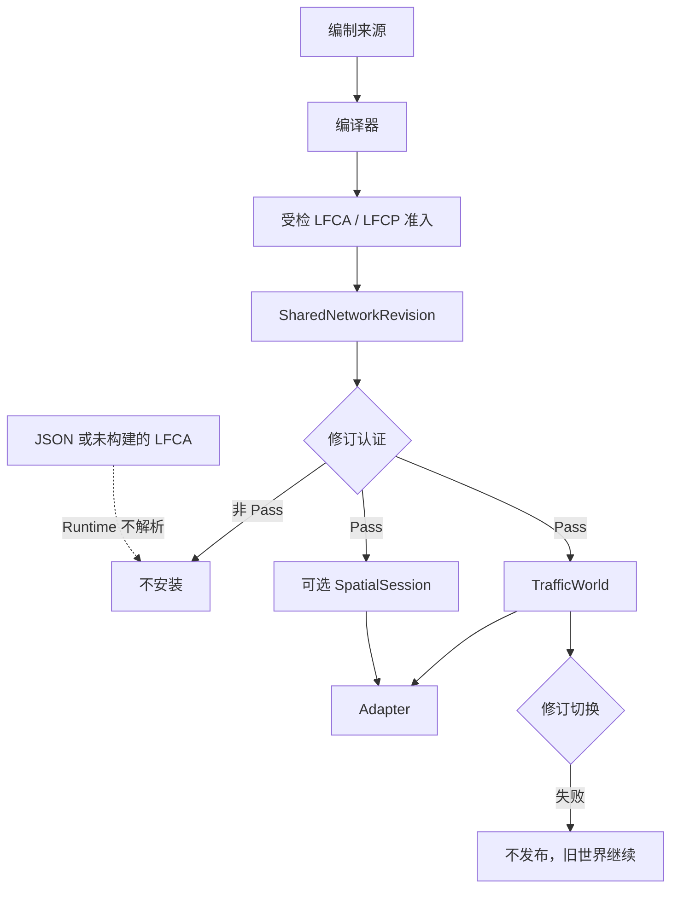
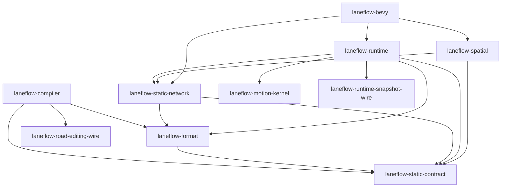

# 架构

**文档状态**: Active（现行系统视图；规范正文在 ADR 与 `docs/design/`）<br>
**最后更新**: 2026-11-11<br>
**适用范围**: 当前宿主分层、生产数据流、crate 依赖与所有权、交通世界生命周期、领域权威归属，以及已实现、已接受但未实现和长期方向的边界

本文只描述开工基线 `eaa5d0357e2e20ba49fbc2f4e55249ba846fccb0` 上的现行系统。
算法、格式字段和失败枚举以链接的专题合同为准。本文不新选运行时架构，也不把
专题正文搬进总览。

## 1. 系统上下文

LaneFlow 是可嵌入、引擎无关、确定性的道路交通运行时与工具链。宿主分层以
[ADR 0021](adr/0021-traffic-infrastructure-and-host-boundary.md) 为准：

| 层级                 | 裁决内容                                                                     |
| -------------------- | ---------------------------------------------------------------------------- |
| 宿主应用层           | 人口、经济、土地利用、建筑、物流任务与游戏规则                               |
| 出行与交通编排层     | 出行需求、出发时刻、参与单元生成、目的地、人口生命周期与路线选择策略         |
| 路径规划服务         | 从静态路网和已提交动态成本快照生成候选路径；不在固定步进内做全图寻路         |
| 编译器与共享静态路网 | 静态标识、拓扑、几何、规则、索引、执行约束和静态布局                         |
| 交通运行时           | 固定步进、已实现执行域的参与单元、动态通行定义、信号、冲突、停驻和每世界状态 |
| 引擎适配器与表现层   | 宿主生命周期、实体、变换、动画、细节层次、界面和调试可视化                   |

当前唯一可运行特化是道路机动车 `TrafficWorld`（`laneflow-runtime`）。
`VehicleState`、每世界 `Route` 和停车占用是这一执行域的投影，不是全部交通参与
单元的终态模型。非机动车、行人和轨道执行域仍是长期方向。

出行需求决定谁在何时出发；路径规划决定候选路径；交通运行时决定参与单元如何在
所属执行域里安全推进。路径算法留在宿主。Runtime 导出已提交观测，并验证、注册
候选动态通行定义。合同见
[观测与路径规划接入](design/traffic-observation-and-routing-integration.md)。

## 2. 生产数据流

编制来源进入编译器，经受检 LFCA / LFCP 准入建成 `SharedNetworkRevision`。
`TrafficWorld` 安装这根修订；需要位姿时，`SpatialSession` 绑定同一根修订。
Adapter 只消费世界和可选会话。



失败关闭点：

- 修订认证结论不是 `Pass` 时，宿主不把该修订用于安装、恢复、Spatial 绑定或切换。
  认证只读，不改变这些入口的签名。见
  [状态完整性](design/traffic-runtime-state-integrity.md) 与
  [ADR 0032](adr/0032-runtime-state-integrity-and-distortion-disposition-authority.md)。
- `TrafficWorld` 不解析 JSON，也不把 LFCA 当作安装格式。共享修订只由
  `laneflow-static-network` 从受检 LFCA 构建。Runtime 对 `laneflow-format` 的
  生产依赖用于切换时的 LFSD 认证和 LFRS 准入。
- 修订切换无法证明等价、超限或映射失败时不发布切换事件，旧世界继续。见
  [修订切换](design/traffic-runtime-revision-cutover.md)。

后发射检查失败时不返回 `PostEmissionCheckedBundle`，也不构建共享修订。发布加载
先核对 LFCP v2 绑定，再消费受检 LFCA；本地确认建造直接消费该 bundle。两条路
建成的都是同一类 `SharedNetworkRevision`。可移植对象现行版本是 LFCA 5、LFSM 4、
LFSD 4、LFCP 2。道路编辑来源 `format_version = 4` 是另一条版本轴。见
[可移植规范制品](design/portable-canonical-artifact.md)、
[后发射检查](design/compiler-post-emission-check-and-minimal-publication-closure.md)
与 [ADR 0023](adr/0023-road-editing-state-and-phased-network-replacement.md)。

## 3. Crate 依赖与所有权

下图只画 LaneFlow 生产依赖。第三方 crate、可选 `laneflow-format-mmap`，以及
只出现在 dev-dependencies 里的 compiler、spatial 和 `serde_json` 不在图中。
编译器与 `laneflow-static-network` 之间没有生产依赖：编译器发射受检制品，共享
修订由 `build_shared_network_revision` 另一次构建。



`laneflow-runtime` 与 `laneflow-spatial` 互不依赖。多个世界用 `Arc` 克隆复用同一
根 `SharedNetworkRevision`；修订拥有自己的连续数组，不借用 LFCA 的 backing。
`SpatialSession::bind` 绑定这根 `Arc`。无 Spatial 组件时返回 `Ok(None)`；有
Spatial 但没有 lane-pose 时绑定失败。同时持有世界和会话的 Adapter 必须让
`TrafficWorld::revision()` 与 `SpatialSession::revision()` 满足 `Arc::ptr_eq`。
当前 Bevy 会话在失配时拒绝创建或换绑。见
[共享静态路网](design/shared-static-network.md)、
[空间几何](design/spatial-geometry.md) 与
[Adapter API](design/adapter-api.md)。

正常生产入口是：

```text
TrafficWorld::install(
    Arc<SharedNetworkRevision>,
    WorldConfig,
    ExecutionConfig,
    CommittedNetworkSource,
    world_id,
    WorldPolicySelection,
)
```

`PostEmissionCheckedBundle` 按值持有 LFCA、LFSM、LFSD 三个来源句柄。它是进程内
能力，不表示已发布或可信。`canonical_network_input(self)` 消费 bundle，只留下
LFCA 与已完成的检查证明。安装签名与这条入口的合同见
[共享消费 §4](design/traffic-runtime-shared-consumption.md#4-公开入口)。该文里
按 #301 切片写下的 1-worker 和“尚未交付快照/切换”不是当前实现边界；并行、快照
和切换以本节之后的专题为准。

## 4. 生命周期

### 安装

`install` 一次绑定完整共享修订、世界配置、执行配置、已提交来源、世界身份和
路权策略选择。来源的 `NetworkRevisionId` 必须与修订 origin 一致。失败不留下
可观察的半个世界。交通准备完成之后，执行配置超出后端能力或执行计划失败都会
拒绝安装，不静默降级。见
[共享消费 §4](design/traffic-runtime-shared-consumption.md#4-公开入口) 与
[执行配置](design/traffic-runtime-execution-config.md)。

### 执行策略

`ExecutionConfig` 携带非零 worker 数，不进入快照、摘要或共享静态路网。当前
后端接受 1–16。1 在调用线程上计算，不创建辅助线程；2–16 由该世界独占的池线程
计算，调用线程只等待。这是已实现的执行配置。城市性能仍未认证。见
[并行执行](design/traffic-runtime-parallel-execution.md) 与
[ADR 0030](adr/0030-single-world-parallel-execution.md)。

### 路线注册

静态路网不预编译路线。调用方把有序边序号交给 `TrafficWorld::register_route`，
出现记录只进入该世界的表。稳态步进使用稠密句柄，不扫描共享路网里的路线表。见
[ADR 0029](adr/0029-retire-precompiled-static-route.md) 与
[路线](design/route-system.md)。

### 步进

`step` 按世界固定步长推进已提交状态。阶段协议用 P0–P8 表达读写边界，不要求
九次遍历。精确路径在同一逻辑边界提交，不因分区多延迟一拍。见
[阶段协议](design/traffic-runtime-phase-protocol.md) 与
[ADR 0003](adr/0003-runtime-tick-and-determinism.md)。

### 观测

世界按观测导出节奏交出已提交交通观测。宿主用它构造动态成本快照，再把候选路径
交回 Runtime 验证和注册。修订不匹配的候选失败关闭。LaneFlow 不提供路径算法
crate。见
[观测与路径规划接入](design/traffic-observation-and-routing-integration.md)。

### 快照与恢复

已实现的生产快照是 Runtime Snapshot v7：LFRS `formatVersion = 7`、
`runtime_state_version = 5`、确定性状态摘要版本 `8`（BLAKE3-256）。worker 数与
`ExecutionConfig` 不进入快照。含活动过渡的世界在保存时返回
`SnapshotCaptureError::UnsupportedTransitionState`。这是已实现的版本合同，不是
性能或资源认证。见
[快照 §2](design/traffic-runtime-snapshot.md#2-版本轴与绑定集)、
[快照 §5](design/traffic-runtime-snapshot.md#5-保存与恢复) 与
[ADR 0033](adr/0033-digest-role-and-algorithm-selection-authority.md)。

### 修订切换

在线修改路网时，旧世界继续步进，候选在失败关闭的切换事务里追赶已提交变更。
提交窗口只把新修订和切换事件发布一次。失败、放弃或无法证明等价时零事件，旧根
继续有效。见
[修订切换](design/traffic-runtime-revision-cutover.md#8-失败关闭故障映射)。

## 5. 领域位置

本节只说明权威归属和实现状态。

### 路口

编译器把 `Junction`、`Movement`、`ManeuverPath` 和 `ManeuverGate` 写入静态路网。
`register_route` 在本世界编译出现记录。路线拥有车辆实际通过；信号控制器和
Adapter 不拥有最终通行权。这一静态身份和出现记录已实现。见
[路口模型](design/road-junction-model.md) 与
[ADR 0017](adr/0017-static-road-junction-maneuver-and-gate-identity.md)。

### 横断面与准入

`RoadCorridor` 组织方向性 `RoadSection` 和可选 `LaneGroup`。`FacilityBand`
是非遍历设施，进入共享静态路网。静态准入在车辆生成和替换时按参与者类别
检查路线后缀，已实现。`FacilityBand` 作为准入目标时，编译器拒绝该能力。时变
准入的运行时求值已接受但未实现。见
[横断面与准入](design/cross-section-access.md) 与
[ADR 0018](adr/0018-multimodal-cross-section-and-access-overlay.md)。

### Waiting 与 Conflict

Waiting 资格、Conflict 出现记录、显式路权策略和预约由 `TrafficWorld` 在固定
步进里联合裁决。Spatial 拥有规范几何，不拥有通行权。该运行时路径已实现。见
[Waiting / Conflict](design/waiting-zone-conflict-right-of-way.md)、
[路权策略](design/traffic-runtime-right-of-way-policy.md)。

### 停车

共享修订保存设施、显式泊位几何、虚拟容量和锚点，不保存预约或占用。占用裁决在
`TrafficWorld`：显式泊位与虚拟容量都以 tagged binding 管理，已实现。停驻车辆
保留身份；无位姿不等于移除。见
[停车](design/parking-system.md) 与
[ADR 0010](adr/0010-parking-binding-and-vehicle-lifecycle-authority.md)。

### 信号

控制器产生指示，Gate 与停止线表达空间准入，合规策略解释许可，纵向约束保证
结果不可绕过。Adapter 只查询和表现。固定时制已实现。感应式和自适应控制不是
现行能力。见 [信号](design/signal-system.md) 与
[ADR 0009](adr/0009-signal-indication-gate-and-policy-separation.md)。

已提交一维几何是整数毫米和 `mm/s`。见
[ADR 0028](adr/0028-integer-millimeter-traffic-geometry.md)。

## 6. 扩展边界

按能力查阅使用条件和已知限制，见[当前能力与限制](reference/capabilities.md)。

已实现、已接受但未实现、已验收且绑定基线、未认证是四种不同事实。Accepted 设计
不自动等于已实现或已认证。

### 已实现

- 道路机动车 `TrafficWorld`，以及编译器、受检 LFCA、`SharedNetworkRevision`、
  可选 `SpatialSession` 和 Bevy 参考适配器这条生产路径。
- 安装、固定步进、每世界路线注册、观测导出、快照 v7 / state 5 / digest 8、
  失败关闭的修订切换，以及投入使用前的修订认证。
- 路口静态身份、横断面静态模型、静态准入、Waiting / Conflict、显式与虚拟停车、
  固定时制信号。
- 固定预制过渡换道。活动过渡拒绝保存。
- worker 1–16 的执行配置。

### 已接受但未实现

- 时变准入的运行时求值。
- `FacilityBand` 作为 `AccessRule` 目标。编译器目前拒绝这一能力。

v0.10 的五轴汇总是已验收且绑定基线 `c0045f8f` 的结论。其中 performance 与
resource 为未认证，城市 Routing 为授权豁免，LuST 不在该基线内。该结论不是当前
`main` 的性能或 LuST 认证。并行合同仍把城市性能标为未认证；本文不做新的认证。
证据范围见
[路线图的 v0.10 验收结论](roadmap.md#v010-验收结论)。

### 长期方向

- 非机动车、行人和轨道执行域。`ParticipantClass` 只是准入分类。
- 任意位置变道，以及 LuST 真实路网五轴验收。二者是已裁定的 v0.11 能力目标，
  还没有作为现行行为实现，也没有认证。固定预制过渡不代表任意位置模型。
- 道路编辑的直接调整与影响预览。当前生产是确认建造后的整修订替换。见
  [ADR 0023](adr/0023-road-editing-state-and-phased-network-replacement.md)。
- `JunctionGroup`、感应式或自适应信号、运行中完整性轮转校验，以及用多频率或
  表现层细节层次代替单世界保真度。这些都需要各自的后续设计，当前合同没有把
  它们写成已实现能力。
- 城市级单世界扩展和 v1.0 的产品范围。它们不是 v0.11 的隐含内容。见
  [路线图](roadmap.md)。
